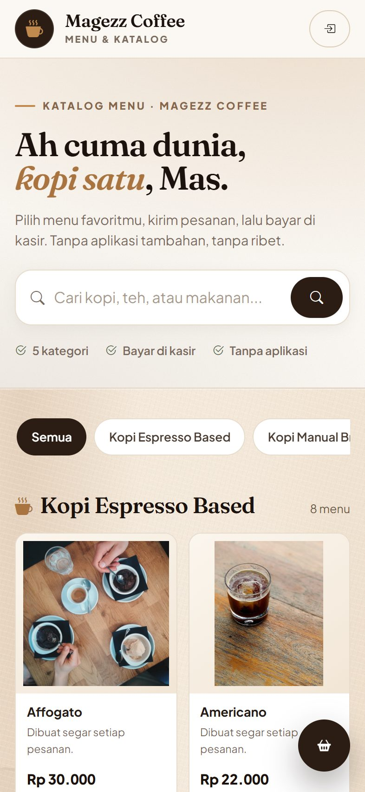
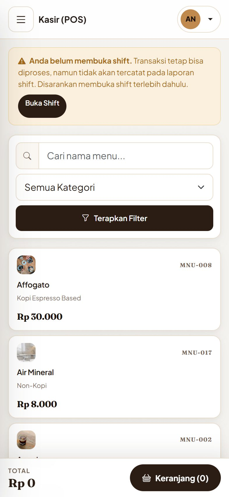
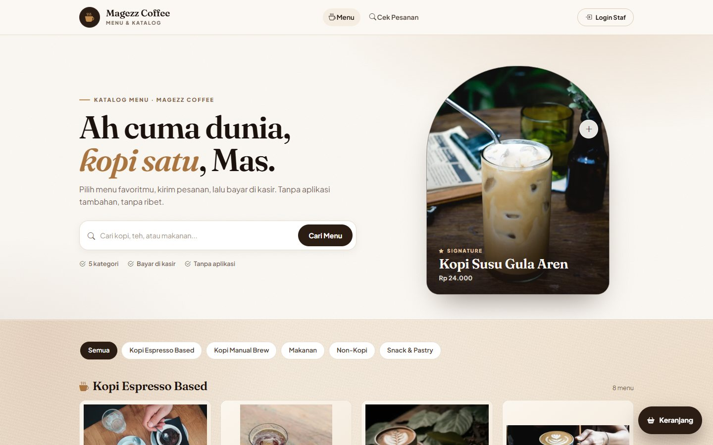

# Magezz Coffee — Sistem Manajemen Coffee Shop

Aplikasi manajemen coffee shop berbasis web yang mencakup **POS (kasir)**, **dashboard admin**, manajemen menu, pesanan online pelanggan, laporan penjualan, serta shift & absensi karyawan.

Dibangun dengan **Laravel 12 + MySQL**, sesuai PRD Magezz Coffee (Fase 1: POS + Dashboard Admin).

---

## Daftar Isi

- [Fitur](#fitur)
- [Tampilan](#tampilan)
- [Teknologi](#teknologi)
- [Persyaratan Sistem](#persyaratan-sistem)
- [Instalasi](#instalasi)
- [Foto Menu](#foto-menu)
- [Akun Demo](#akun-demo)
- [Hak Akses](#hak-akses)
- [Struktur Database](#struktur-database)
- [Alur Bisnis Utama](#alur-bisnis-utama)
- [Struktur Proyek](#struktur-proyek)

---

## Fitur

### Fase 1 (MVP) — Sudah tersedia

| Modul | Keterangan |
|---|---|
| **Autentikasi & Peran** | Login, logout, pembatasan akses berdasarkan peran (Manager / Kasir), serta lockout 5 menit setelah 3 percobaan gagal (eskalasi kelipatan 5 menit, maksimal 60 menit) |
| **Dashboard** | Ringkasan omzet harian & bulanan, item terjual, grafik penjualan 7 hari, produk terlaris |
| **Kasir (POS)** | Katalog menu dengan pencarian & filter kategori, keranjang, varian (suhu, ukuran, level gula, extra shot, susu, topping), diskon persen/nominal, pajak PB1, multi-metode pembayaran, struk cetak thermal 80 mm |
| **Transaksi** | Riwayat transaksi, filter, detail, cetak struk, dan void (pembatalan) dengan catatan alasan, pelaku, dan waktu |
| **Kategori** | CRUD kategori menu |
| **Menu** | CRUD menu, harga, foto menu, penanda menu signature, serta status aktif/nonaktif |
| **Pesanan Online** | Katalog publik, keranjang, pengiriman pesanan, cek status, kode pesanan acak, batas 10 pesanan per menit per IP, total sudah termasuk pajak, dan pembatalan beralasan |
| **Laporan Penjualan** | Filter periode/metode/kasir, ringkasan omzet, grafik harian, produk terlaris, ekspor CSV, dan halaman cetak A4 |
| **Shift Kasir** | Buka/tutup shift, kas awal, rekonsiliasi kas, perhitungan selisih kas otomatis, audit penutup shift, filter tanggal/karyawan/status |
| **Absensi** | Clock-in / clock-out, koreksi oleh Manager dengan alasan, riwayat koreksi, dan rekap operasional harian |
| **Pengguna** | CRUD akun karyawan (khusus Manager) |
| **Pengaturan** | Nama outlet, alamat, telepon, footer struk, tarif & status pajak |

### Fase 2 — Belum diimplementasikan

Aplikasi mobile pelanggan (Flutter), loyalty/membership, promo & voucher, notifikasi.

---

## Tampilan

| Katalog menu (ponsel) | POS kasir (ponsel) | Katalog menu (desktop) |
|---|---|---|
|  |  |  |

---

## Teknologi

| Komponen | Teknologi |
|---|---|
| Backend | Laravel 12 (PHP 8.2+) |
| Database | MySQL 8 |
| Frontend | Blade + Bootstrap 5.3 (CDN) + Bootstrap Icons |
| Grafik | Chart.js 4 (CDN) |
| Server lokal | Laragon (Apache/Nginx atau `php artisan serve`) |

> Tampilan memakai CDN sehingga **tidak perlu** menjalankan `npm install` / `npm run build`.

---

## Persyaratan Sistem

- PHP **8.2** atau lebih baru
- Composer 2
- MySQL 8
- Ekstensi PHP: `pdo_mysql`, `mbstring`, `openssl`, `fileinfo`, `curl`, `zip`, `gd`, `xml`

---

## Instalasi

### 1. Clone / tempatkan proyek

Proyek dapat diletakkan di folder web server Anda, misalnya `C:\laragon\www\coffeeshop`.

### 2. Siapkan database

Jalankan MySQL, lalu buat database:

```sql
CREATE DATABASE magezz_coffee CHARACTER SET utf8mb4 COLLATE utf8mb4_unicode_ci;
```

### 3. Konfigurasi environment

Salin `.env.example` menjadi `.env` (bila belum ada) dan sesuaikan:

```env
APP_NAME="Magezz Coffee"
APP_URL=http://localhost:8000

DB_CONNECTION=mysql
DB_HOST=127.0.0.1
DB_PORT=3306
DB_DATABASE=magezz_coffee
DB_USERNAME=root
DB_PASSWORD=
```

### 4. Install dependensi & generate key

```bash
composer install
php artisan key:generate
```

### 5. Migrasi & isi data awal

```bash
php artisan migrate --seed
```

Data awal mencakup: 2 akun pengguna, 5 kategori, dan 28 menu dengan foto contoh.

### 6. Jalankan aplikasi

```bash
php artisan serve
```

Buka **http://localhost:8000**

> Bila memakai Laragon, cukup akses melalui virtual host Laragon (mis. `coffeeshop.test`) tanpa `artisan serve`.

### Foto menu

Manager dapat mengunggah foto menu dari halaman **Manajemen Menu**. File disimpan di
`public/uploads/menus` melalui disk `menus` (tanpa perlu `php artisan storage:link`).
Format yang didukung: JPG, PNG, dan WebP, maksimal 2 MB.

Sebanyak 28 foto contoh sudah disertakan untuk menu demo. Sebagian besar berasal dari
FoodiesFeed dengan lisensi CC0; dua foto pelengkap berasal dari Flickr dengan lisensi
CC BY / CC BY-SA. Sumber, kreator, dan lisensi foto tercatat di
[`public/uploads/menus/CREDITS.md`](public/uploads/menus/CREDITS.md). Foto berlisensi
CC BY-SA tetap tunduk pada ketentuan lisensi masing-masing.

Setiap foto juga dibuatkan varian **WebP** berukuran 320/640/960 px agar katalog tetap
ringan di HP (total unduhan halaman katalog turun dari ±5,6 MB menjadi ±1,2 MB). Varian
dibuat otomatis saat manager mengunggah foto; untuk foto yang sudah ada jalankan:

```bash
php artisan images:optimize --dry-run   # lihat rencana tanpa menulis berkas
php artisan images:optimize             # buat varian (--force untuk menimpa)
```

Varian disimpan berdampingan dengan aslinya (`nama-320.webp`, dst.) dan dipakai melalui
atribut `srcset`, sehingga browser memilih ukuran sesuai lebar layar. Foto asli tidak
diubah, jadi bisa dijadikan cadangan.

### Aset brand, favicon & halaman error

Identitas visual disimpan langsung di `public/`:

| Berkas | Fungsi |
|---|---|
| `public/favicon.ico` | Favicon multi-ukuran (16/32/48 px) |
| `public/favicon.svg` | Favicon vektor untuk browser modern |
| `public/apple-touch-icon.png` | Ikon iOS (180 px) |
| `public/icon-192.png`, `public/icon-512.png` | Ikon web manifest |
| `public/site.webmanifest` | Manifest PWA ringan (nama, warna tema, ikon) |
| `public/images/og-cover.png` | Gambar pratinjau 1200×630 saat tautan dibagikan |

Ketiga layout memuat favicon dan meta Open Graph. Khusus `css/magezz.css`, pemuatan
memakai helper `asset_v()` di `app/Support/helpers.php` yang menambahkan `?v=<filemtime>`
sehingga browser tidak menyimpan CSS lama setelah diperbarui.

Halaman error bertema tersedia di `resources/views/errors/` (403, 404, 419, 500, 503,
serta fallback `4xx`/`5xx`). Halaman ini berdiri sendiri dan tidak bergantung pada
database, jadi tetap tampil rapi saat terjadi kegagalan sistem.

---

## Akun Demo

| Peran | Email | Kata Sandi |
|---|---|---|
| Manager | `andhika@magezz.test` | `password` |
| Kasir — Alexander | `alexander@magezz.test` | `password` |
| Kasir — Veronica | `veronica@magezz.test` | `password` |

> **Penting:** Ganti kata sandi sebelum digunakan di lingkungan produksi.

---

## Hak Akses

| Fitur | Manager | Kasir |
|---|:---:|:---:|
| Dashboard | ✅ (semua kasir) | ✅ (milik sendiri) |
| Kasir (POS) | ✅ | ✅ |
| Transaksi (lihat) | ✅ (semua kasir) | ✅ (milik sendiri) |
| Void transaksi | ✅ | ❌ |
| Shift & Absensi | ✅ (semua karyawan) | ✅ (milik sendiri) |
| Koreksi absensi | ✅ | ❌ |
| Kategori & Menu | ✅ | ❌ |
| Laporan Penjualan | ✅ | ❌ |
| Pengguna | ✅ | ❌ |
| Pengaturan | ✅ | ❌ |

Implementasi: middleware `role` (`app/Http/Middleware/RoleMiddleware.php`).

**Isolasi data kasir:** untuk role Kasir, dashboard (omzet hari ini/bulan ini, produk terlaris, transaksi terbaru), daftar transaksi, detail transaksi, struk, serta ringkasan dan riwayat shift hanya menghitung data milik akun itu sendiri (`user_id`). Membuka transaksi kasir lain secara langsung ditolak dengan **403**. Manager tetap melihat data seluruh kasir.

---

## Struktur Database

| Tabel | Fungsi |
|---|---|
| `users` | Akun pengguna + kolom `role`, `phone`, `is_active` |
| `categories` | Kategori menu |
| `menus` | Menu/produk + harga, foto (`image_path`), status aktif, penanda signature |
| `shifts` | Shift kasir + kas awal, kas aktual, selisih, dan `closed_by` |
| `attendances` | Absensi harian (clock-in/clock-out) |
| `attendance_corrections` | Riwayat koreksi absensi oleh Manager beserta alasan |
| `orders` | Pesanan online + subtotal, pajak, total, dan audit pembatalan (`cancel_reason`, `cancelled_by`, `cancelled_at`) |
| `order_items` | Detail item pesanan online (snapshot nama & harga) |
| `transactions` | Header transaksi + total, diskon, pajak, metode bayar, audit void (`voided_by`, `voided_at`, `void_reason`) |
| `transaction_items` | Detail item per transaksi (menyimpan snapshot nama & harga) |
| `settings` | Konfigurasi aplikasi (nama outlet, pajak, footer struk) |

**Catatan desain:** `transaction_items` menyimpan *snapshot* nama dan harga menu, sehingga riwayat transaksi lama **tidak berubah** bila harga menu diperbarui — sesuai kriteria penerimaan PRD.

**Catatan integritas:** kombinasi `user_id` + `date` pada tabel `attendances` bersifat unik, sehingga satu karyawan hanya memiliki satu catatan absensi per tanggal. Jika ada beberapa shift dalam satu hari, `clock_in` memakai jam masuk paling awal dan `clock_out` memakai jam keluar paling akhir. Setiap koreksi Manager dicatat di `attendance_corrections` beserta alasannya.

---

## Alur Bisnis Utama

### Transaksi penjualan

1. Kasir membuka **shift** (opsional, disarankan) dengan mengisi kas awal.
2. Kasir memilih menu di halaman **POS**, memilih varian, dan menambah ke keranjang.
3. Sistem menghitung: `subtotal → diskon → pajak PB1 → total`.
4. Kasir memilih metode pembayaran (Tunai / QRIS / Kartu) dan memproses.
5. Sistem menyimpan transaksi lalu menampilkan struk.

### Void transaksi

Manager dapat membatalkan transaksi dengan alasan. Status berubah menjadi `void`, dan alasan, pelaku, serta waktu pembatalan tersimpan di `void_reason`, `voided_by`, dan `voided_at`.

### Pembatalan pesanan online

Kasir atau Manager dapat membatalkan pesanan. Alasan pembatalan wajib diisi dan tercatat di `cancel_reason`, `cancelled_by`, serta `cancelled_at`. Jika pesanan sudah dibayar, transaksi terkait ikut di-void dengan alasan yang sama.

### Buka & tutup kas

Saat tutup shift, sistem menghitung:

```
Kas Seharusnya = Kas Awal + Total Penjualan Tunai
Selisih Kas    = Kas Fisik Aktual − Kas Seharusnya
```

Selisih ditampilkan sebagai *surplus* atau *defisit*. Jika ada selisih, Manager wajib mengisi catatan alasan saat menutup shift. Penutup shift juga dicatat pada kolom `closed_by`.

### Absensi & koreksi

1. Kasir melakukan clock-in dan clock-out manual untuk **hari ini**.
2. Bila ada beberapa shift dalam satu hari, sistem memakai clock-in paling awal dan clock-out paling akhir.
3. Manager dapat mengoreksi absensi karyawan untuk tanggal lampau melalui form **Koreksi Absensi**.
4. Koreksi wajib menyertakan alasan dan tersimpan di riwayat koreksi.

---

## Struktur Proyek

```
app/
├── Console/Commands/       # OptimizeMenuImages (varian WebP foto menu)
├── Http/
│   ├── Controllers/        # AuthController, PosController, MenuController, dll.
│   └── Middleware/         # RoleMiddleware, EnsureActiveUser
├── Models/                 # User, Category, Menu, Shift, Attendance, AttendanceCorrection, Transaction, Setting
├── Services/
│   ├── CartService.php           # Keranjang & kalkulasi harga
│   ├── LoginThrottleService.php  # Lockout login berjenjang
│   ├── OrderService.php          # Pembuatan pesanan & kode acak
│   └── TransactionService.php    # Pembuatan transaksi & kode acak
└── Support/
    ├── MenuImage.php       # Pembuatan & srcset varian WebP
    └── helpers.php         # Helper rupiah(), rupiah_decimal(), asset_v()

database/
├── migrations/             # Migrasi tabel
└── seeders/                # Data awal (kategori, menu, user)

public/
├── favicon.ico  favicon.svg  apple-touch-icon.png
├── icon-192.png  icon-512.png  site.webmanifest
├── images/og-cover.png     # Pratinjau tautan (Open Graph)
├── css/magezz.css          # Tema Coffee Editorial
└── uploads/menus/          # Foto menu (asli + varian WebP 320/640/960)

resources/views/
├── layouts/app.blade.php   # Layout utama (sidebar + topbar)
├── layouts/public.blade.php
├── errors/                 # Halaman error bertema (403/404/419/500/503)
├── auth/                   # Halaman login
├── dashboard.blade.php
├── pos/                    # Antarmuka kasir
├── menus/  categories/
├── transactions/           # Daftar, detail, struk
├── reports/  shifts/  attendances/  users/  settings/

.github/workflows/tests.yml  # CI: Pint + PHPUnit (MySQL)
docs/screenshots/           # Tangkapan layar untuk README

routes/web.php              # Semua rute + middleware peran
```

---

## Catatan

- **Tampilan mobile**: pada layar < 992px sidebar staf berubah menjadi *drawer* (tombol hamburger di topbar), dan pada < 768px muncul *bottom navigation* (Dasbor, Kasir, Pesanan, Shift, Lainnya). Halaman POS memakai bar total yang menempel di bawah. Semua layout memakai `viewport-fit=cover` + `env(safe-area-inset-*)` agar aman di iPhone, dan ukuran font input dinaikkan ke 16px supaya Safari tidak melakukan auto-zoom. Tabel data staf otomatis berubah menjadi kartu di layar < 768px, jadi tidak perlu digeser ke samping.
- **Cetak**: struk memakai kertas thermal 80 mm (nama outlet, alamat, dan footer diambil dari Pengaturan), sedangkan laporan punya gaya cetak A4 — sidebar, filter, dan tombol disembunyikan, header periode muncul otomatis, dan header tabel diulang di setiap halaman.
- Format mata uang: **Rupiah (Rp)**, tanpa desimal pada tampilan.
- Pajak default: **PB1 10%**, dapat diubah/dinonaktifkan di menu Pengaturan.
- Total yang dilihat customer di katalog, keranjang, dan halaman status **sudah termasuk pajak**, sehingga sama dengan tagihan kasir saat checkout.
- Perhitungan uang memakai `decimal(12,2)` agar tidak ada galat pembulatan floating point.
- Data awal (menu & harga) mengacu pada Lampiran A PRD dan bersifat contoh — silakan sesuaikan.
# magezz-coffee

